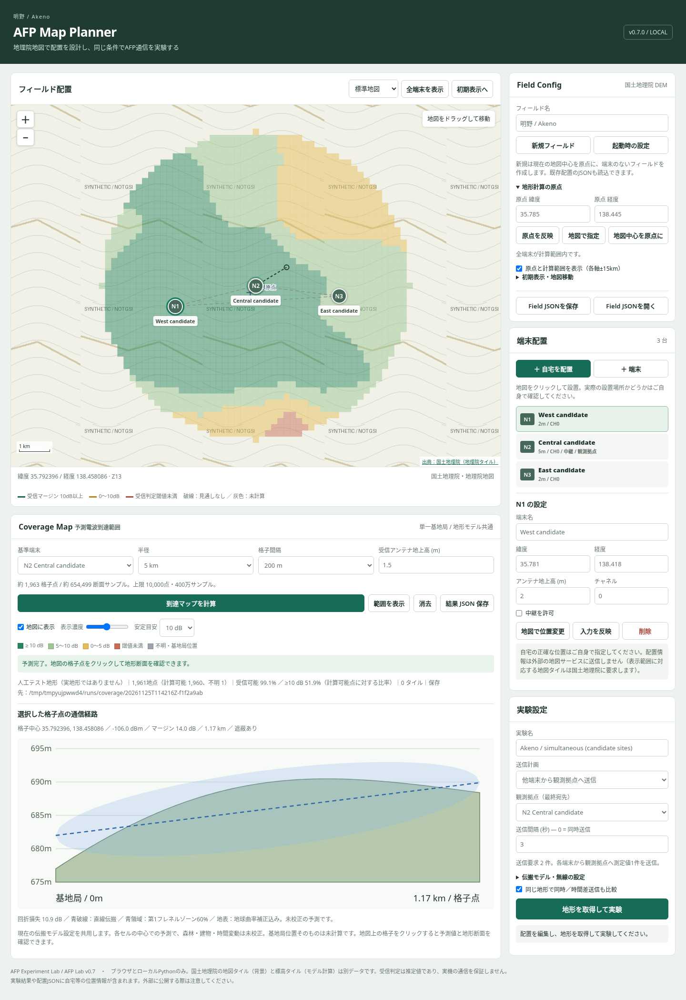

# AFP Lab

[English](README.md) · [明野データ実験フィールド](https://akeno-data-field.kenkoichiban.jp/) · [MITライセンス](LICENSE)

**技術ではなく、知りたいことから始める。**

AFP Lab（AKENO Field Protocol Lab）は、地域のセンサーデータ収集を手軽にするため、無線通信・電波伝搬・設備設計を研究するオープンな実験基盤です。山梨県北杜市明野での活動を起点としますが、特定の地域や通信方式の普及を目的にしません。既存技術で十分なら活用し、課題や学習目的が明確になったときに独自技術を研究します。

## 本体プロジェクト：明野データ実験フィールド

**[明野データ実験フィールド — 活動公式サイト](https://akeno-data-field.kenkoichiban.jp/)**

AFP Labは、明野データ実験フィールドの技術研究を担うリポジトリです。活動サイトは地域の人や一般の読者に知りたいこと、観測、発見を伝える場所。GitHubは技術者・研究者が設計、実装、再現方法、疑問、改善提案を共有する場所です。AFPを使っていない方の参加も歓迎します。

## 3つの研究領域

| 研究 | 問い | v0.7の到達点 |
| --- | --- | --- |
| Protocol Research | どう通信すればよいか | AFPの仮想通信、マルチホップ、ACK、衝突・キュー実験 |
| Radio Field Research | どこに設置すればよいか | 地形を考慮した点対点予測、面的な到達マップ |
| Field Engineering | どう設置し維持すればよいか | 電源・アンテナ・筐体・施工・実測の研究計画（実機実装前） |



*v0.7のブラウザ試験画面。背景・標高は人工データ、座標は説明用。実測結果ではありません。*

## すぐ試す

Python 3.10以上とブラウザがあれば動きます。追加Pythonパッケージや無線機は不要です。Windowsでは `python`、macOS/Linuxでは環境に応じて `python3` を使用してください。リポジトリのルートで実行します。

```sh
python -m unittest -v
python -m afp_lab.lab --out experiments/demo --open
```

8シナリオをオフライン実行できます。ブラウザが開かなければ `experiments/demo/index.html` を開いてください。同時送信と時間差送信、人工地形上の比較などをNetwork Observatoryで観察できます。

地理院地図による配置と電波到達マップは次のコマンドです。

```sh
python -m afp_lab.planner --open
```

<http://127.0.0.1:8765/> が開きます。サンプルの端末は設置候補を説明するための座標で、実際の設備や自宅の場所ではありません。Coverage Mapで基準端末、半径、格子間隔、受信アンテナ高を指定して計算します。初めは半径3km、200m間隔がおすすめです。地図・標高タイルは未キャッシュ時に国土地理院へアクセスします。詳細は[操作ガイド](docs/usage.md)を参照してください。

## 何が分かり、何がまだ分からないか

- 74件の自動テスト、8シナリオ。Windowsで全テストと実GSI地形の1,961格子計算、Linuxで全テストを確認しています。
- AFPの通信ロジックをRadio Interface、端末時計、Local Recorderから分離。仮想無線場だけが持つ真値を端末に渡しません。
- 地形予測は単一ナイフエッジ・固定追加損失・受信感度閾値による近似で、実測校正前です。緑の領域も安定通信を保証しません。
- 実機用AFPファームウェア、E220実ドライバー、再送・動的経路・暗号化・認証・時刻同期は未実装です。災害時通信は将来の応用研究であり、安全を保証する通信設備ではありません。

## リポジトリ構成

```
afp-lab/
  afp_lab/              Pythonパッケージ（通信・仮想実験・地形・各種ツール）
    web/                Map Planner / Observatory のHTMLテンプレート
  tests/                74件の自動テスト
  configs/
    geography/          地域カタログと配置サンプル
    scenarios/          8種類の実験条件
  examples/             初期プロトタイプの記録例
  docs/                 設計・進化の歴史・技術調査・原資料
  .github/              CI・Issueテンプレート
```

公開用にパッケージ化しましたが、通信・電波伝搬のアルゴリズムは変更していません。リポジトリのルートから `python -m afp_lab.lab`、`python -m afp_lab.planner` などで起動できます。追加インストールや `PYTHONPATH` 設定は不要です。実験結果、キャッシュ、非公開データは従来どおりローカル管理です。

## 技術資料

- [設計の進化 v0.1–v0.7（日本語）](docs/design-evolution.ja.md) — 7段階の構成図から、技術的な問いと設計判断の歴史を読む
- [Design evolution（英語）](docs/design-evolution.md) / [Architecture and contracts](docs/architecture.md)
- [E220のソース調査・実験課題（日英）](docs/e220-research.md) — メーカーの実装、内蔵ファームウェア、仮想モデルを区別
- [Field Engineering（日英）](docs/field-engineering.md) — 筐体、アンテナ、電源、センサー、施工と保守
- [検証結果](docs/validation.md) / [各版の原資料](docs/history/README.md)
- [参加方法](CONTRIBUTING.md) / [データ・出典・プライバシー](docs/data-and-privacy.md)

## ライセンス

AFP Labのオリジナルのソフトウェア・文書はMITライセンス。地理院タイルなど第三者のデータは対象外であり、各提供元の利用条件に従います。M5StackやEbyte、Meshtastic等の第三者製品・プロジェクトの公式実装ではありません。
