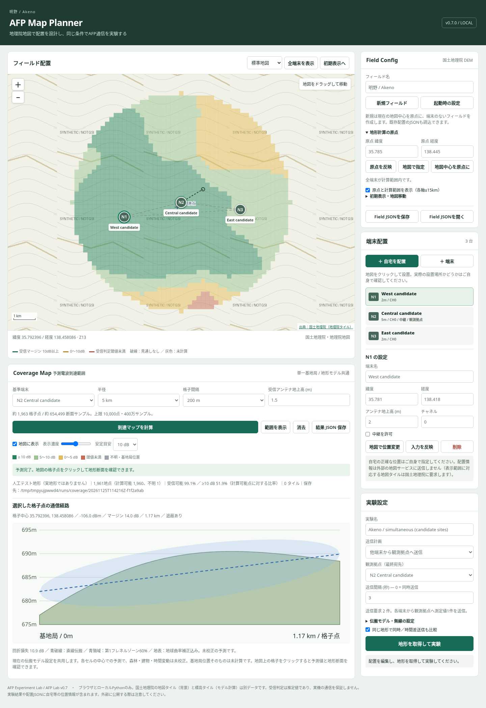

# AFP Lab

[日本語](README.ja.md) · [Akeno Data Experimental Field](https://akeno-data-field.kenkoichiban.jp/) · [MIT License](LICENSE)

**Start with what we want to know, not with technology.**

AFP Lab (AKENO Field Protocol Lab) is an open experimental platform for studying local sensor networks, low-power radio communication and terrain-aware radio coverage. It originated in the Akeno Data Experimental Field in Hokuto, Yamanashi, Japan. Our goal is to make local observation and analysis accessible, not to promote a particular radio protocol. Existing technologies should be used when they satisfy the requirements; independent development is an option when a concrete gap or learning objective has been identified.

## Research areas

| Area | Question | Current scope |
| --- | --- | --- |
| Protocol Research | How can we deliver small observations efficiently and reliably? | Experimental AFP packet format, multi-hop simulation, ACK, collision and queue experiments |
| Radio Field Research | Where should devices be placed? | Terrain-based point-to-point prediction and single-source coverage map using GSI elevation data |
| Field Engineering | How can we install and maintain equipment? | Research plan: enclosure, antennas, power, sensors, installation and field measurements; hardware implementation pending |

## Parent project: Akeno Data Experimental Field

**[Akeno Data Experimental Field (明野データ実験フィールド) — official project website](https://akeno-data-field.kenkoichiban.jp/)**

AFP Lab is the technical research repository of the broader field project. The activity website introduces our questions, observations and discoveries to residents and general readers. This repository is for developers and researchers who want to inspect the implementation, reproduce experiments, discuss assumptions and contribute. Contributions are welcome even if you use Meshtastic, LoRaWAN or another radio system rather than AFP.

## Current baseline: v0.7



*Map Planner v0.7 browser fixture: synthetic terrain and background, example coordinates only. This is a deterministic prediction, not measured coverage. The UI is currently mainly Japanese.*

- Python 3.10+, standard library only; no package installation or radio hardware required for simulations.
- 8 bundled scenarios; 74 automated tests. Verified on Windows (Python 3.15 series) by the project and on Linux in the packaging environment.
- E220-inspired virtual UART radio, independent node clocks, local/field JSONL streams, offline collection and a browser-based Network Observatory.
- GSI DEM acquisition/cache with tile hashes, frozen link profiles, configurable region, placement editor and single-base coverage overlay. A real GSI-backed 1,961-cell calculation completed on Windows.

**Research software, not production firmware.** No physical AFP radio driver or MCU firmware is included. AFP does not implement authenticated encryption, automatic retries, dynamic routes, time synchronization, or a regulatory compliance engine. Predictions are not calibrated; do not rely on this software for emergency communications or safety-critical decisions. No radio transmission is performed by the included code.

## Quick start

Open a terminal in the repository root. Use `python` or `python3` according to your installation (on Windows `py -3` also works).

```sh
python -m unittest -v
python -m afp_lab.lab --out experiments/demo --open
```

The eight scenarios run offline. If your browser does not open automatically, open `experiments/demo/index.html`. Compare `02_collision` with `05_staggered`, or the synthetic hills scenarios `07` and `08`. Raw records are in `experiments/demo/traces/`. Rebuild a report from records without running the simulator:

```sh
python -m afp_lab.lab --collect experiments/demo/traces/01 experiments/demo/traces/06 --out experiments/replay --open
```

### Map Planner and coverage prediction

```sh
python -m afp_lab.planner --open
```

Open <http://127.0.0.1:8765/> if needed. The default field is an illustrative three-node layout near Akeno, not installed equipment or private home locations. Select or add a base node. In the Coverage Map panel choose the source, radius (start with 3 km), grid spacing (200 m) and receiving antenna height (1.5 m). Run the calculation and click a cell for the estimated RSSI and path profile. Change color thresholds without recomputing; add candidate nodes while retaining the overlay. Results are saved under `experiments/planner/coverage/`.

The planner runs locally. Background map and DEM tile requests use the Geospatial Information Authority of Japan (GSI); internet access is required for uncached tiles. Use `--cache PATH` to reuse an existing DEM cache; `--config PATH` loads a Field JSON. `--offline` limits DEM acquisition to the cache, not browser map requests. Saved coverage JSON is not yet directly reloadable as an overlay. Read the [user guide](docs/usage.md) and [data/privacy notes](docs/data-and-privacy.md).

## Repository layout

```
afp-lab/
  afp_lab/              Python package (protocol, simulation, terrain, tools)
    web/                Map Planner and Observatory HTML templates
  tests/                74 automated tests
  configs/
    geography/          Field catalog and sample layout
    scenarios/          Eight repeatable scenarios
  examples/             Example trace from the first prototype
  docs/                 Architecture, design evolution, history, research
  .github/              CI and issue template
```

Run the tools from the repository root using `python -m afp_lab.lab`, `python -m afp_lab.planner`, or `python -m afp_lab.terrain`. The public package layout was reorganized without changing the simulation or propagation algorithms. No editable install, `PYTHONPATH` adjustment or external Python dependency is needed. Generated results, caches and private inputs remain local.

## Technical documentation

| Document | Content |
| --- | --- |
| [Design evolution (EN)](docs/design-evolution.md) / [設計の進化 (JA)](docs/design-evolution.ja.md) | Seven architecture diagrams, questions, decisions and evidence from v0.1–v0.7 |
| [Architecture and contracts](docs/architecture.md) | Packet layout, radio abstraction, experiment recording, terrain and coverage |
| [E220 investigation / research questions](docs/e220-research.md) | Source-review observations and bench-test proposals, not confirmed hardware bugs |
| [Field Engineering](docs/field-engineering.md) | Research agenda for safe, maintainable physical infrastructure |
| [Validation](docs/validation.md) | Test evidence, repeatable baselines and explicit limitations |
| [Historical documents](docs/history/README.md) | Original design notes, user guides and development test logs |
| [Contributing](CONTRIBUTING.md) | Reproducible reports and constructive technical discussion |

## License and attribution

Original AFP Lab software and documentation: [MIT](LICENSE). GSI tiles and other third-party materials are not relicensed by this repository. See [data sources and privacy](docs/data-and-privacy.md). No third-party radio firmware is bundled. M5Stack, Ebyte, LoRa and Meshtastic are referenced for interoperability and comparison; this is an independent project, not an official implementation or endorsement.
