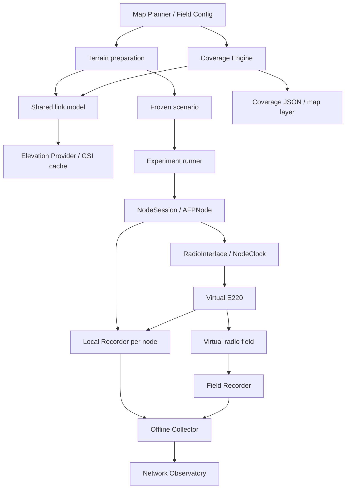

# Architecture and contracts (v0.7)

The actual Python and HTML implementations are the authoritative reference for this baseline. These diagrams describe logical boundaries rather than deployed hardware.



## Source map

The public repository groups Python modules under `afp_lab/`, browser templates under `afp_lab/web/`, tests under `tests/`, and editable research inputs under `configs/geography/` and `configs/scenarios/`. These are file-organization boundaries, not new runtime layers. `afp_lab/paths.py` locates the repository and its resources relative to the package. The commands are run from the repository root; no Python package installation is required.

| File | Responsibility |
| --- | --- |
| `afp_lab/afp.py` | Packet codec, legacy v0.1 simulator (`afp_lab/demo.py`); current host imports the codec |
| `afp_lab/node.py` | AFPNode and NodeSession: host logic and per-node commands |
| `afp_lab/contracts.py` | `RadioInterface`, `RxFrame`, `NodeClock` |
| `afp_lab/runtime.py` | Event engine, virtual clocks, clock mapping, polled monotonic scheduler |
| `afp_lab/radio.py` | VirtualE220 and Field; approximate UART/RF behavior |
| `afp_lab/lab.py` | Normalize/split scenario, run, record and write report |
| `afp_lab/recorder.py` | JSONL, stream manifest, offline collection, observation boundaries |
| `afp_lab/dem_gsi.py`, `afp_lab/providers.py` | Elevation acquisition/cache/provenance; trusted map/provider definitions |
| `afp_lab/field_config.py` | Field Config and default catalog |
| `afp_lab/paths.py` | Bundled config and web resource paths |
| `afp_lab/terrain.py` | Shared link physics, profiles, frozen scenario |
| `afp_lab/coverage.py` | Grid planning, bounds, deterministic point predictions and inspection |
| `afp_lab/planner.py`, `afp_lab/web/planner.html` | Loopback HTTP service and map/coverage editor |
| `afp_lab/web/observatory.html` | Self-contained experiment report visualization |

## AFP wire format (experimental version 1)

`struct.Struct('>BBHHIBH')`, big endian, fixed header 13 bytes. Bytes are not a Meshtastic or LoRaWAN frame.

| Offset | Bytes | Field |
| ---: | ---: | --- |
| 0 | 1 | Version (=1) |
| 1 | 1 | Kind (DATA=1, ACK=2) |
| 2 | 2 | Original source |
| 4 | 2 | Final destination |
| 6 | 4 | Sequence |
| 10 | 1 | TTL |
| 11 | 2 | Payload length |
| 13 | variable | Payload |

The deduplication key is `(kind, src, dst, seq)`. A destination delivers DATA once, schedules an ACK back to the original source with the same sequence, and removes matched pending ACKs on arrival. An enabled relay forwards a new non-local packet with TTL decremented if TTL > 1. Link destination (default `0xffff` broadcast) is independent of the final AFP destination. There is no application-level broadcast delivery protocol, retry timer, persistence, authenticated encryption or route learning. The virtual maximum frame is configurable; 200 bytes includes the AFP header (187-byte payload budget with that setting). This is not a certified E220 capacity guarantee.

## Radio abstraction

```python
class RadioInterface(Protocol):
    address: int
    def send(self, payload: bytes, destination: int = BROADCAST,
             channel: int | None = None) -> bool: ...
    def set_receiver(self, callback: Callable[[RxFrame], None]) -> None: ...
    def capabilities(self) -> dict: ...
```

The return value denotes host queue admission only. A UART write and RF transmission have different lifetimes. VirtualE220 separates host queue capacity and a hidden internal module queue. The host callback receives `RxFrame(payload, rssi)` only; no SNR, previous RF hop or field TX identifier. An RSSI may be absent. Virtual collision and RF duration models are illustrative. Host completion notification is not implemented as an RF-completion guarantee. A future physical adapter may support different capabilities, but should not silently manufacture unavailable observations.

## Experiment records and observation

NodeSession receives only its own commands. Each Recorder writes a schema-1 JSONL stream: experiment/stream ID, mode, source, node ID, event sequence, local microseconds, event and fields. Manifest descriptors declare counts and completeness, with optional clock mapping. Collector derives host delivery/ACK metrics from sufficient local records and RF metrics only from available complete field records; missing data must remain unknown. RTT uses the source's local monotonic clock. A mapping aligns timestamps for observation, not protocol synchronization. See [v0.3 trace contract](history/README-v0.3.md#ログ契約trace-schema-1).

## Geography and radio predictions

The geographic JSON separates map viewport, local-plane origin and actual nodes. `terrain.prepare()` freezes DEM-derived profiles and provenance. The link model uses a local equirectangular approximation, effective Earth radius 4/3, FSPL, a single dominant knife edge, fixed additional loss and a sensitivity threshold. In dB units:

`predicted RSSI = TX power + total antenna gain - FSPL - diffraction loss - extra loss`

It does not model buildings, trees, weather, multipath, capture, radio noise or probabilistic delivery. The virtual field uses the predicted threshold to choose candidate receivers, then models overlapping transmissions and half duplex. It cannot infer interference from below-threshold signals. The default assumptions (e.g. 923 MHz, 13 dBm, -120 dBm threshold, 15 dB extra loss for the Akeno sample) are experimental inputs, not a radio configuration or legal approval.

Coverage v0.7 validates a one-node or multi-node field, generates grid centers within a circle, invokes the same path model, and stores `afp-coverage-v1` results. The base center is unknown (zero separation). Off-grid cells are null, missing elevation is unknown, and corrupt tiles/network failures stop the run. Profiles are regenerated from saved inputs with cache-only DEM reads and compared against saved predictions and tile hashes. Each cell is a point estimate, not a promise over its entire area. Limits: 10 km radius, 50–500 m spacing, 10,000 cells, 4 million profile samples and a local plane within ±15 km per axis. The UI offers a subset of valid ranges. Pairwise experiments require 2–20 nodes.

## Physical portability

A possible physical adapter would run the same wire format and node semantics on an MCU, with a real RadioInterface, local clock and recorder. This is a design goal, not an existing firmware implementation. Compare binary test vectors, host-visible events and explicit capability declarations before trusting cross-platform equivalence. E220, direct SPI radios, and existing protocols may be studied using the same field conditions without pretending they have identical APIs.
