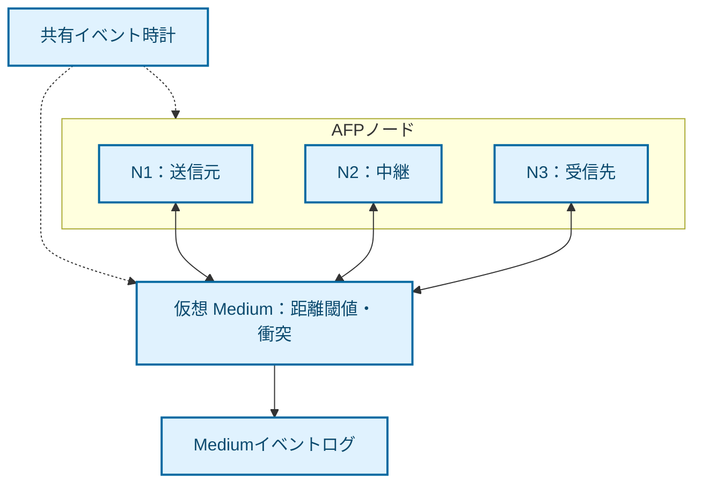
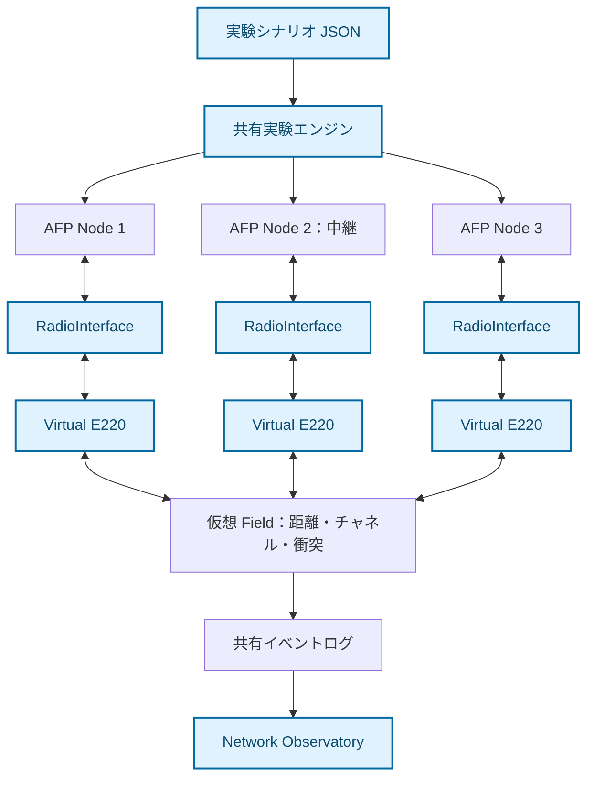
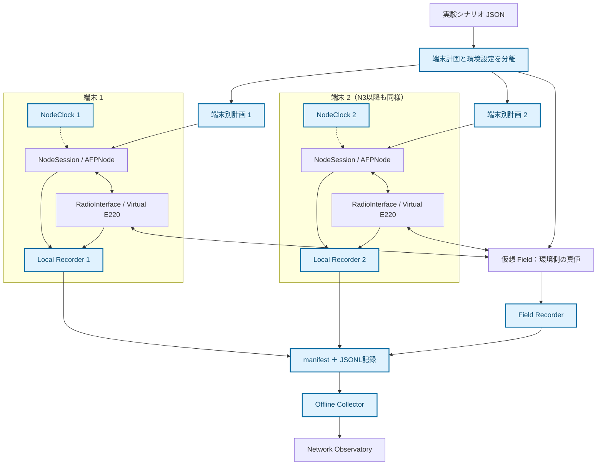
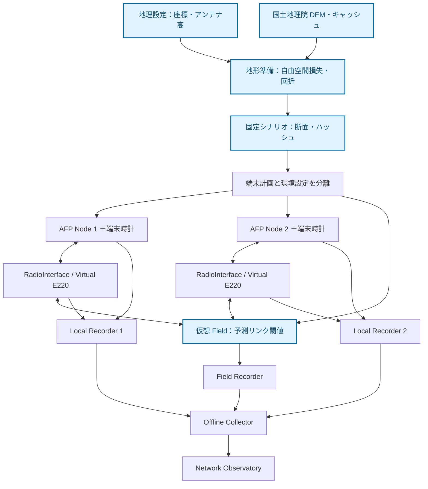
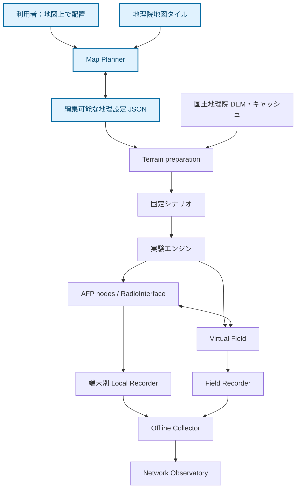
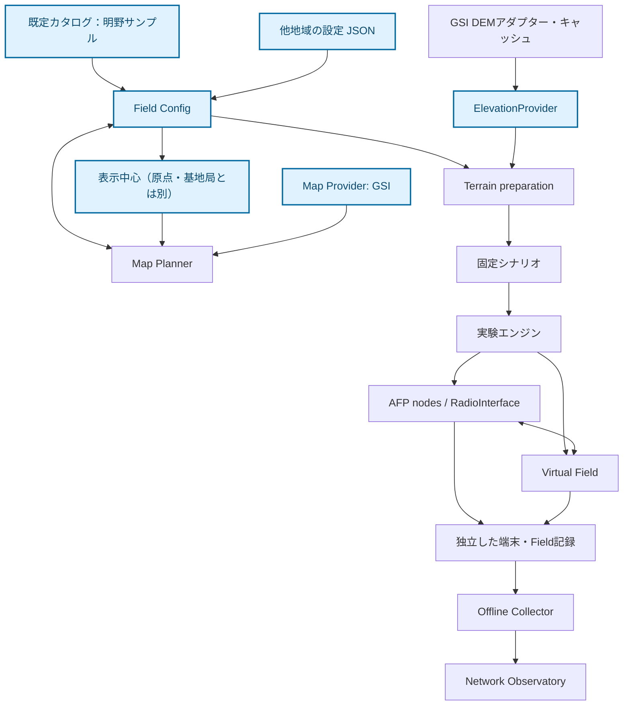
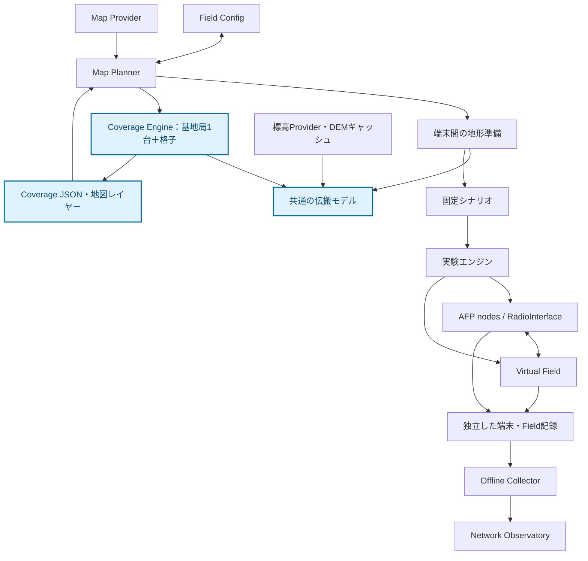

# AFP Lab — 設計の進化 v0.1–v0.7

[English](design-evolution.md) · [README](../README.ja.md) · [原資料](history/README.md)

## 何を知りたいのか

明野データ実験フィールドの目的は、身近な環境を計測し、データを収集・分析して理解すること。地域にある観測点の小さな計測値を、携帯電話網に依存せず、低い費用で届けられるかを考えた。LoRaはその候補であり、AFP（AKENO Field Protocol）は通信の仕組みを実験するための仮説である。LoRaWANやMeshtasticのような既存方式も研究対象とし、採用を前提にしない。

初期に選んだ実機候補はAtom Liteと日本向けM5Stack Unit LoRa E220。UARTの無線モジュールに対する通信制御を検討しながら、実機到着前にPCで原理を理解できる環境を作った。以下は2026年11月25日までの開発の技術的な流れであり、当時の文書を単に連結したものではない。後日の実機検証と区別する。

**図の読み方：** 青色の枠はその段階で追加・変更された主要な責務。白／既定色は継続する責務。矢印はデータや制御の関係を表し、物理配線やRFリンクの全てを示すものではない。図は当時の実装を説明するための概念図で、当時の設計書・READMEは[原資料](history/README.md)として保存している。

## v0.1 — 最小のプロトコルを動かす

**問い：** 中継を通じてデータとACKを届けるには、最低限どのような情報が必要か。同時送信では何が起きるか。

13バイトのバイナリヘッダーとDATA/ACK、送信元・宛先・連番・TTLによる基本的なフラッディングを実装。決定的イベント時計と仮想半径で中継・衝突・半二重を説明する。3件のテスト。ここで得たのは最小の通信モデルであり、実機の再現ではない。無線空間と端末が直接結びついている点を次の課題とした。

*最小の通信モデル。ノードが仮想Mediumを直接呼び出す。*

## v0.2 — 無線機とプロトコルの分離

**問い：** E220のように内部処理が見えない無線機を、端末はどう扱うべきか。

無線送受信をRadio Interfaceに分け、ホストの送信キュー、UART（宛先2バイト＋チャネル1バイト）、無線側処理、アドレスフィルタ、チャネルと衝突をモデル化。送信要求の受付を電波送信完了と混同しない。5シナリオとNetwork Observatoryを導入し、15件のテストで比較可能にした。アドレスが違っても電波が干渉するという点が重要。実機の無線状態や正確なRF時間までは分からない。

*無線抽象化を追加。UART・キュー・RF処理をプロトコルの下に置く。観測ログはまだ共有。*

## v0.3 — 仮想世界の全知性を取り除く

**問い：** 実機で取得できない情報を仮想端末が使っていないか。観測を別の場所で再現できるか。

端末時計（NodeClock）、端末別の計画（NodeSession）、各端末のLocal Recorder、仮想空間のField Recorderを分離。`RxFrame`はpayloadと任意のRSSIのみ。直前の物理送信元や衝突の真因は提供しない。UART完了と内部キュー/RF送信を分けた。Collectorは保存されたmanifestとJSONLを読むだけで再集計でき、欠損記録・未同期の時刻を未知のまま扱う。観測窓を明示し、30件のテスト。実機に必要な共通契約は定義されたが、実機ファームウェアはまだない。

*端末別の時計・計画・観測を導入。Fieldだけが知る真値は観測側に残す。代表2端末を表示。*

## v0.4 — 地形と通信の関係を研究する

**問い：** 地域の実際の地形では、距離だけで通信可能性を判断できるか。

国土地理院の標高タイルを取得・キャッシュし、標高断面、自由空間伝搬損失、地球曲率、フレネルゾーン、単一ナイフエッジ回折からリンクを予測する。地形を準備済みシナリオに固定し、データ来歴を保存。AFPノードには地形表を渡さず、仮想無線場だけが伝搬モデルを使う。人工の丘を使った同時送信／時間差送信を追加し8シナリオ、43件のテスト。地形予測と観測を混同しない。実地形の取得と実際の電波測定は別の検証である。

*地形で変わるのはFieldの伝搬モデルであり、AFPノードには全体のリンク表を渡さない。*

## v0.5 — 地図で設置候補を考える

**問い：** 座標を手入力せず、実験参加者が地図を見ながら設置場所を設計できるか。

ローカルWeb UIのMap Plannerを導入。地図上で端末を追加・移動し、アンテナ高と実験条件を設定して従来の実験エンジンを起動する。Field JSONを保存・読込。同じ固定地形で送信タイミングを比較。UIは設定の作成者であり、AFPを変更しない。53件のテスト。

*Map Plannerは実験条件を作る新しい入口。通信方式と既存の観測基盤は維持。*

## v0.6 — 明野と研究基盤を分ける

**問い：** 他地域でも同じ仕組みを使えるか。

サンプル地域を 当時の `geography/catalog.json`（公開版では `configs/geography/catalog.json`）とField Configに分離。地図の表示中心、局所平面の原点、基地局を別々に扱う。地図提供元と標高提供元の契約を分ける。GSIのみ実装済みで、海外DEMに対応したわけではない。別地域の人工DEM試験と従来8シナリオの回帰を行い63件のテスト。明野は実験する場所であり、研究基盤そのものではない。

*明野は選択可能な設定データになる。地図・標高提供元を分離するが、実装済みはGSIのみ。*

## v0.7 — 端末を置く前に到達性を知る

**問い：** 設置地点を一つずつ想像する代わりに、基地局から周囲の到達性を俯瞰できないか。

`coverage.py`を追加し、既存の地形断面・伝搬計算を共通化。1台の基準端末と仮想受信点の格子だけで計算し、AFPノードを大量生成しない。地図に受信マージンを重ね、クリックで断面を再計算。条件、結果、DEMのSHA-256を保存。色の閾値変更や基地局以外の端末の配置変更は再計算不要。上限10,000点・400万断面サンプルを設けた。既存通信実験8シナリオのsummaryを維持し、74件のテスト。Windowsでは実GSIを取得し1,961点の計算を完了した。モデル精度の実証ではない。

*面的予測は通信実験を経由しない。点対点と共通の伝搬計算を使い、格子点はAFPノードにしない。*

## 現在の責務分担

| 研究領域 | 何を変えるか | 何を固定するか |
| --- | --- | --- |
| Protocol Research | 送信間隔、中継方式、将来の再送など | 地形・無線条件・送信要求 |
| Radio Field Research | 設置場所、アンテナ高、伝搬仮説 | 通信方式・無線設定 |
| Field Engineering | 筐体、電源、設置方法、センサー | 比較したい条件以外の機器構成 |

研究基盤は仮説→仮想実験→実機計測→差分の分析→改善という循環を支援する。現在は前半の実験基盤が整った段階。実機実装を急ぐより、どの情報を知りたいかを明確にし、既存技術でできることを調べる。AFPを採用しない結論も、研究として有効である。
