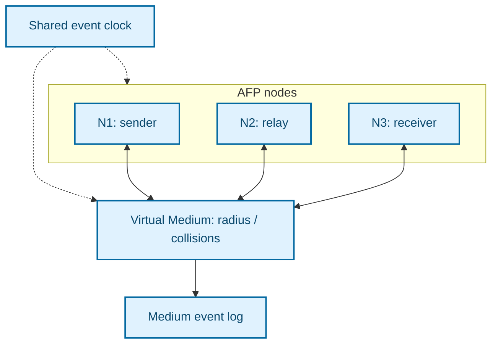
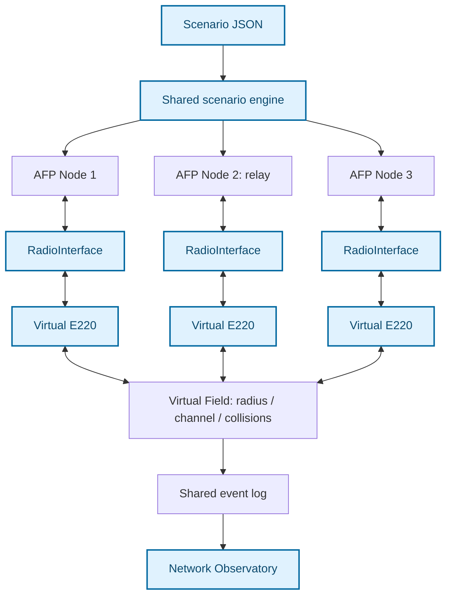
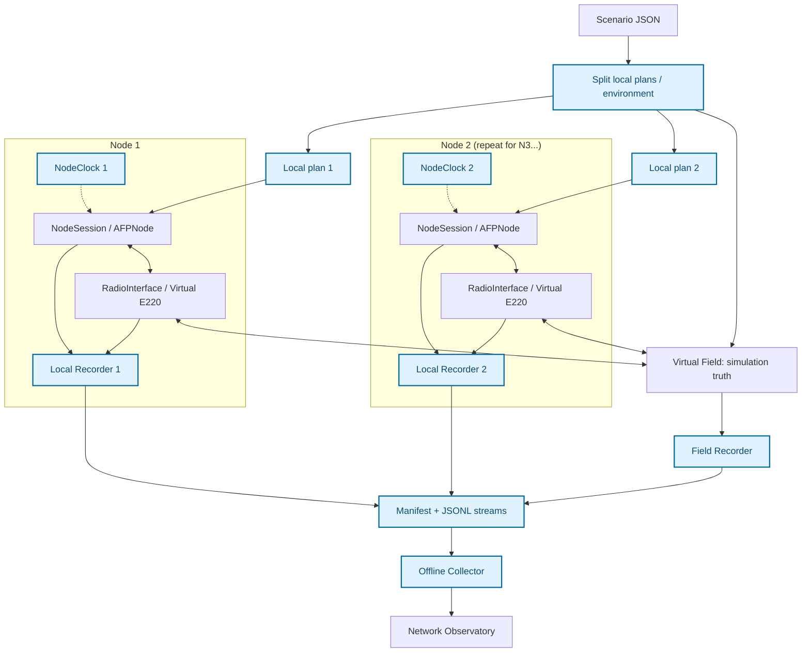
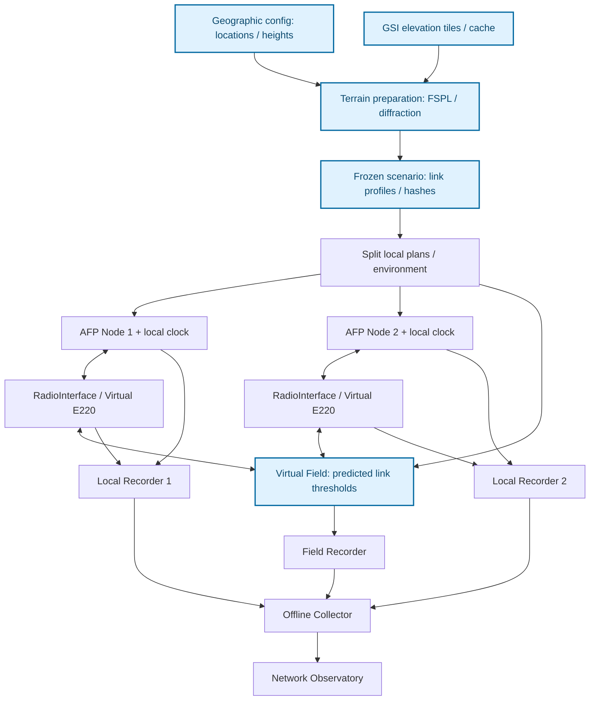
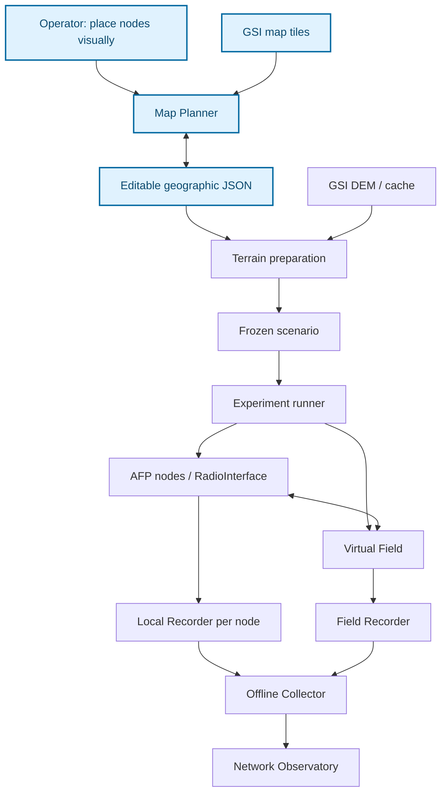
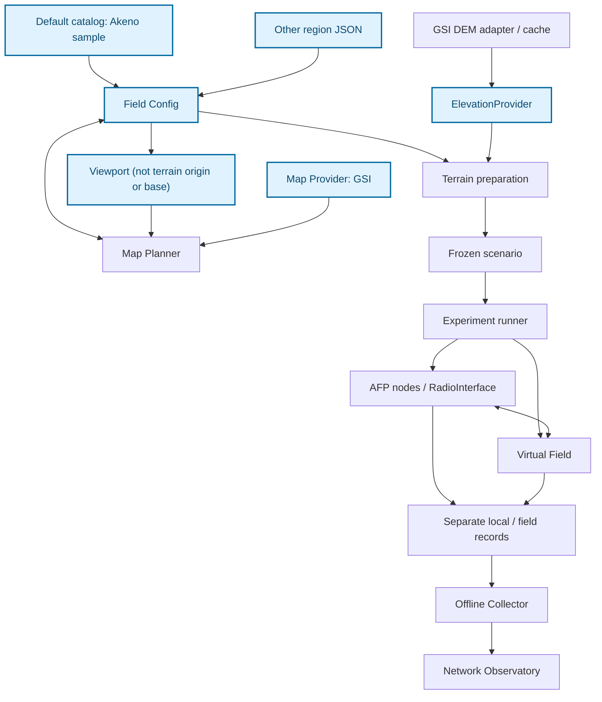
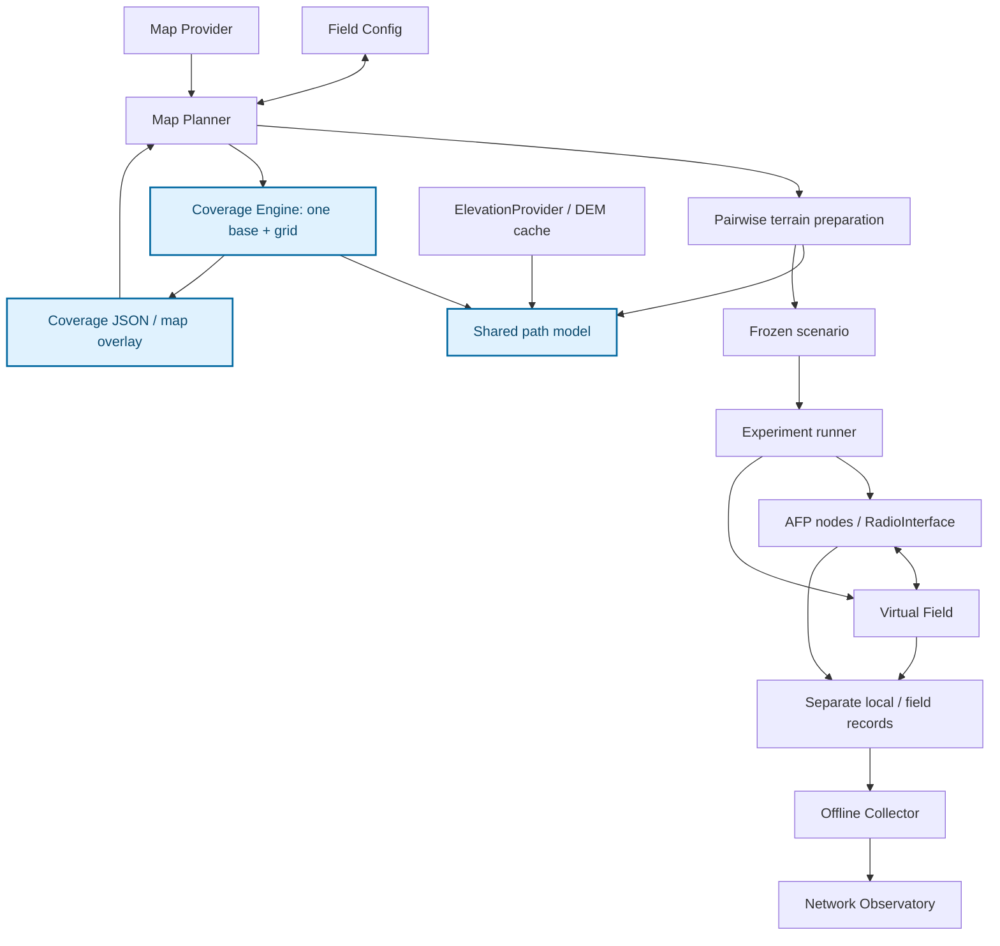

# Design evolution: v0.1–v0.7

[日本語・詳細版](design-evolution.ja.md) · [Original design notes](history/README.md)

This is a narrative of the design questions rather than a reconstructed Git commit history. The seven prototypes were developed before the first public repository. We preserve the working v0.7 code and the original notes, not invent seven historical commits. The objective is to make local observation and analysis accessible. AFP is a learning and experimental protocol, not a technology that every deployment must use.

| Version | Research question | Decision and result | Tests |
| --- | --- | --- | ---: |
| v0.1 | What is the minimum packet and relay mechanism? | Binary DATA/ACK, TTL, duplicate suppression, radius-based deterministic medium. Demonstrates collision and half duplex, not real hardware. | 3 |
| v0.2 | How should a protocol see a UART radio? | Separate the radio interface, approximate host UART, addressing, queues and RF behavior; add five scenarios and Network Observatory. | 15 |
| v0.3 | Is the simulated node using knowledge unavailable to a physical node? | Independent node clocks, local plans and local recorders, separate field truth, explicit observation window; offline collector preserves missing and unsynchronized data. | 30 |
| v0.4 | Can terrain make two equal-distance links behave differently? | GSI DEM, local projection, Fresnel clearance, dominant knife-edge and frozen profiles. Terrain is an environment input, not host knowledge. Add synthetic-hill comparison. | 43 |
| v0.5 | Can non-specialists plan candidate placements visually? | Loopback Map Planner: configure nodes on a map, save/load JSON, run paired experiments without changing the protocol. | 53 |
| v0.6 | Can the platform work beyond Akeno? | Separate field configuration, map viewport, local origin and base. Provider interfaces; only GSI implemented. | 63 |
| v0.7 | Can we see coverage before choosing receiver locations? | Reuse the exact link model across a circular grid, with clickable profiles and cached provenance. No simulated AFP nodes needed for coverage. | 74 |

## Architecture through the seven prototypes

Blue outlines highlight the principal new or changed responsibilities at each step. Default-colored elements are retained responsibilities. Arrows show logical data or control relationships, not physical wiring or every RF link. These are explanatory diagrams of the historical implementations, not newly reconstructed Git commits.

### v0.1 — Minimal packet and virtual medium

*Minimal protocol and shared virtual field. Nodes call the medium directly.*

### v0.2 — Radio abstraction

*The radio boundary is introduced. UART, queue and RF behavior sit below the protocol; the field log is still centralized.*

### v0.3 — Independent node views and records

*Each node has its own view and clock. Field-only truth goes to the observation side, not the protocol. Two representative nodes are shown.*

### v0.4 — Terrain-aware field

*Terrain changes the field model, not the AFP node. The node never receives a global propagation table.*

### v0.5 — Visual scenario planning

*The planner is a new way to construct scenarios, not a new radio protocol. Existing simulation and observation remain intact.*

### v0.6 — Field configuration and providers

*Akeno becomes a selectable data configuration. Map and elevation providers are separate; only GSI is implemented.*

### v0.7 — Single-source coverage prediction

*The coverage branch bypasses the packet engine. Both branches use the same physics; grid points are not AFP nodes.*

## Important architectural decisions

- **A radio request is not an RF delivery.** The host admission result, UART completion, hidden module behavior and end-to-end ACK are distinct.
- **No simulation oracle in the host.** The radio callback supplies bytes and optional RSSI. Field-only identities and causes of RF failure remain on the observation side.
- **Records are independent of the simulator.** Local clocks, streams and a manifest can be collected offline. A missing stream is not evidence of a lost packet. A simulated exact clock mapping is not a physical synchronization method.
- **The radio model is independent of AFP.** A prepared terrain scenario freezes the predictions. A coverage grid uses the same path model but no packet engine.
- **Akeno is a field, not a software dependency.** The local coordinate origin is not the source node or map viewport. Geography is configuration; provider adapters may be added when needed.
- **Preserve evidence rather than manufacture certainty.** The final baseline passes 74 automated tests and the eight prior scenario summaries. A Windows GSI-backed coverage run completed 1,961 cells. This verifies operation, not the radio propagation accuracy. See [validation](validation.md).

## From virtual experiments to physical research

Protocol Research studies delivery under controlled conditions. Radio Field Research studies location, propagation and empirical residuals. Field Engineering studies antennas, weatherproofing, sensors, power, installation and maintenance. We intend to use real devices to test all three in the Akeno field. No embedded firmware has been delivered yet.

Meshtastic and LoRaWAN are useful reference systems, not competitors to defeat. If an existing implementation satisfies the observation requirements, use it. If a gap appears, document a testable question, compare with the reference and justify the smallest useful change. Building a prototype for learning is valid; deploying it merely because it was built is not.
