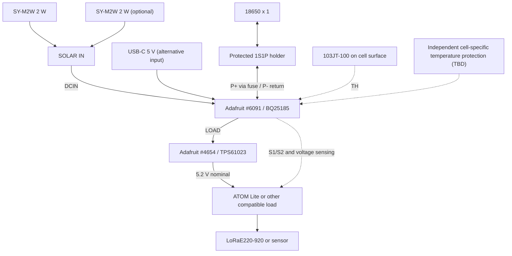

# FE-PWR-001 — Modular Solar Power Supply / モジュール組立式独立太陽光電源

[Field Engineering / フィールド設備技術](../field-engineering.md)

| 項目 | 内容 |
| --- | --- |
| 設計ID | FE-PWR-001 |
| 設計バージョン | Rev. 0.1 |
| 基準日 | 2026-11-27 |
| 状態 | 部材発注完了（5台分）・試作前 |
| 対象 | 観測端末、フィールド集約端末、LoRa中継端末 |
| 関連実験 | FE-05（筐体内温度）、FE-06（端末消費電力） |

> **Research prototype — not validated deployment instructions.**
>
> 本資料は発注時点の設計記録であり、完成品の回路図・製作保証・無人運用手順ではない。充電温度範囲、放電停止条件、負荷の許容電圧、保護協調、異常後の自動復帰、筐体内の温熱・結露等は未検証である。初号機は管理された環境で評価し、各安全条件を満たすまでは屋外・無人充電を行わない。

## English summary

This research prototype is a modular, repairable solar power supply for the Akeno Field Project (AFP Lab). It combines a 2 W solar panel (optionally two identical panels in parallel), one replaceable 18650 Li-ion cell in a protected holder, an Adafruit #6091 BQ25185 power-path charger, an Adafruit #4654 TPS61023 boost converter (nominal 5.2 V), and a SEMITEC 103JT-100 surface thermistor. Five sets of components were ordered on 2026-11-27, but no assembly or performance validation has been completed.

The research aims to establish reproducible, locally maintainable hardware rather than build custom battery electronics from scratch. The target is a shared power module for sensor nodes and relay nodes, including an ATOM Lite and LoRaE220-920 (U170) reference load. Cell-specific charge-temperature protection, voltage compatibility, normal low-voltage cutoff, fuse coordination, automatic recovery and actual energy balance are validation gates. A transparent resin enclosure with an internally mounted solar panel is a thermal and optical experiment, not an established cooling solution.

## 1. Purpose / 設計目的

明野の観測ネットワークを継続して運用するため、商用電源のない地点に設置できる小型電源を研究する。日照に恵まれる一方で冬季には氷点下となる地域条件を考慮する。通信到達性だけでなく、電力自立性と設置・保守の容易さを評価する。

電源は特定の通信方式やセンサーに依存させず、発電、蓄電、電力変換、観測・通信、屋外筐体を交換可能な単位に分離する。既製の電子モジュールを活用し、独自設計の対象を取り付け構造、接続方法、計測、制御及び実験に集中する。

## 2. Requirements / 要求仕様

| 項目 | Rev. 0.1の目標・選択 |
| --- | --- |
| 発電 | SY-M2W 2 W × 1枚を基本、同型2枚並列の4 W構成も評価 |
| 蓄電 | Li-ion 18650 1S1P、3.0–3.6 Ah級（約11–13 Wh、公称3.6 V換算） |
| 充電 | 4.2 V充電仕様のセルに限定。500 mA設定を基本（実電流は発電・負荷・温度に依存） |
| 補助電源 | 充電基板上のUSB-C 5 V入力 |
| 出力 | MiniBoost公称5.2 V、500 mA負荷までを初期評価目標とする。保証値ではない |
| 電力配分 | 充電基板のpower pathにより外部入力を負荷優先に利用 |
| 保護 | セル保護IC、バッテリー側ヒューズ、セル表面NTC、セル仕様に適合する充電禁止条件 |
| 制御 | TH、/CE、S1/S2、EN、電圧計測点を将来利用できる配置 |
| 組み立て | 市販保護回路付きホルダー、リード線付きコネクタ、3Dプリントトレー。セルへの直接ハンダ付けなし |
| 保守 | セル・基板を交換可能とし、設計確定後の組み立て15–30分/台を目標 |
| 原価 | 電源部材は数千円/台、中継端末一式は1.5–1.7万円級を初期予算の目安とする（実績未集計） |
| 運用 | 無人運用は検証完了後。1台の試作結果をもとに残り4台を製作 |

## 3. Architecture / システム構成



概念図であり、ネット名・電流方向を示す。実装用回路図ではない。2枚目のパネルはオプション。USB-CとDCINは代替入力として扱い、同時入力は基板の仕様及び実機で確認するまで使用しない。

### 3.1 Reference load / 中継端末の基準構成

| モジュール | 役割 |
| --- | --- |
| M5Stack ATOM Lite | 制御、Wi-Fi/BLE、UART通信 |
| M5Stack Unit LoRaE220-920 (U170) | 920 MHz帯の送受信、純正アンテナ・Groveケーブル |
| FE-PWR-001 | ソーラー充電、蓄電、給電 |
| 屋外樹脂筐体 | 電源・通信基板の収納、設置、耐候性 |

独自のLoRa通信を使う中継端末を想定し、Wi-Fi等で外部ネットワークへ接続する場合をゲートウェイと区別する。LoRaWAN専用ゲートウェイではない。無線機器とアンテナは適法な構成・設定で利用する（[Field Engineering](../field-engineering.md) 参照）。

## 4. Design decisions / 設計判断

| ID | 採用した判断 | 理由 |
| --- | --- | --- |
| DD-001 | Voltaic V25ではなく既製モジュール組立式 | 国内からの調達、セル・基板交換、計測・制御への拡張 |
| DD-002 | 1S1P | 直列バランシングや複数セルの管理を避ける |
| DD-003 | 初期試作は18650 | 手持ちセル及び既製ホルダーを活用。QB26800は将来候補 |
| DD-004 | 保護IC付き電池ホルダー | セル接点及び保護基板の個別設計・加工を省略 |
| DD-005 | Adafruit #6091 | power path、広いDC入力範囲、外付けNTC、制御端子 |
| DD-006 | DFRobot DFR0559及び一体型#6106を初期採用しない | DFR0559のソーラー入力範囲はSY-M2Wの開放電圧に適合しない。両者とも外付けNTC・充電制御の実装自由度が基本版より小さい |
| DD-007 | Pololu #4941からAdafruit #4654へ変更 | Marketplaceの個別送料・納期を回避し調達を集約。EN、短絡保護等も評価できる |
| DD-008 | SEMITEC 103JT-100 | 薄型でセル表面に密着させやすく、BQ25185の標準NTC特性と整合 |
| DD-009 | 同じ2 Wパネルを並列に増設する案 | リニア充電器の入力電圧を不要に上げず、2 W/4 Wを比較 |
| DD-010 | 透明筐体の天板内側にパネルを取り付ける案 | 外部配線の引き込みを減らし、セルへの直射日光を遮る |
| DD-011 | 独立電源ケースではなく着脱トレー | 組み立て・保守の簡素化、部材削減 |
| DD-012 | ヒーター・電流計測回路・制御コネクタを初期構成から省略 | まず自然昇温と基本電力収支を評価。安全に必要な温度制御は省略しない |

## 5. Electrical design / 電気設計

### 5.1 Solar input

SY-M2Wの公開仕様は2 W、開放電圧6.9 V、短絡電流0.39 A、116 × 116 × 3 mm。

| 構成 | 公称出力 | 開放電圧（公称条件） | 合計短絡電流（公称条件） |
| --- | ---: | ---: | ---: |
| 1枚 | 2 W | 6.9 V | 0.39 A |
| 2枚並列 | 4 W | 6.9 V | 0.78 A |

開放電圧と短絡電流は同時に得られる値ではない。並列時の逆流、逆接続、パネルの許容逆電流及び遮光条件を確認する。異なる方向・日陰条件の場合は必要な逆流防止を評価する。直列接続は入力の電圧差によるリニア充電器の発熱を増やすため採用しない。

#6091のボード推奨DC入力は5–18 V、入力電流は約1 Aが上限。標準充電電流500 mAは入力電流制限とは別である。電流制限・熱制限・負荷優先動作を考慮して4 W構成を実測する。低温時の開放電圧も確認する。パネルを増やすだけで発電電力量が比例するとは限らない。

### 5.2 Charger and boost

- #6091: 1S Li-ion用、標準4.2 V/500 mA、LOAD出力最大4.5 V。BQ25185はバッテリー追従VINDPMを持つリニア充電器で、スイッチング式MPPTではない。
- #4654: TPS61023、出力公称5.2 V、ボードの入力範囲2–5 Vを基準とする。ENで停止でき、ICに短絡・過熱等の保護機能がある。Adafruitの実測では3.7 V入力、100–500 mA出力で約88%の効率。完成機の性能は未測定。
- LOADからMiniBoostを駆動し、入力が存在する際のpower pathを利用する。BATTに昇圧器を直接接続しない。
- 5.2 Vの出力公差・起動時過渡・負荷側の許容電圧を確認し、適合確認が取れるまでATOM LiteやU170を接続しない。必要なら5.0 V出力に適合する別モジュールを選定する。
- 500 mA出力、入力3.0 V、変換効率85%と仮定すると昇圧器入力は約1.02 A。コネクタ、ホルダー、配線、充電基板の電流・電圧降下・温度を確認する。

### 5.3 Connection interfaces (proposed)

| 接続 | 設計方針 |
| --- | --- |
| SOLAR IN | #6091のDCIN/GND、極性を明示 |
| USB-C IN | 基板上の既設端子（メンテナンス用） |
| BATT | ホルダーのP+からヒューズを介してBATT+、P−からBATT− |
| LOAD | #6091 LOADから#4654 IN/GND |
| POWER OUT | #4654 OUT/GNDから適合確認済みの負荷へ |
| TH | セル表面NTCと温度保護回路。外付けNTC有効化には#6091のTHジャンパ変更が必要 |
| /CE, S1, S2 | 充電制御・状態取得の候補。実装は信号定格・既存LED回路・起動時状態を確認してから |
| EN | 昇圧出力停止・低電圧時の負荷切り離し等への利用候補 |
| VBAT sense | 将来の電圧計測用。ADC定格に合わせた分圧等を別途設計 |

BATTとLOADのJST-PHは同形状なので、色・ラベル・配線保持で識別する。リード線の色だけを信用せず現物で極性を照合する。5V出力の外部USB化と専用制御コネクタは今回の対象外。負荷のUSB等からの同時給電や逆流を防ぐ。

### 5.4 Cell and circuit protection

バッテリースペースの1S1P-18650は未保護の18650生セル専用。販売元は過充電・過放電・過電流・短絡保護及び20 AWGのP+/P−リードを明示している。挿入後に充電器による起動が必要で、ホルダー同士の直列・並列使用は禁止されている。

ヒューズはホルダーのP+出力に直列で、可能な限りホルダーに近く置く。2 AのDC対応品を初期候補とし、DC遮断容量、時間電流特性、突入電流、最も細い電線及びコネクタの定格との保護協調を確認してから確定する。セルの直近で起きる短絡や保護回路内の故障を全てカバーできるわけではない。出力側の保護も独立に評価する。

主電源配線は22 AWGを基本とし、短い基板間配線は24 AWGを候補とする。ホルダー付属20 AWGは再利用する。Adafruit #261の既製100 mm JST-PHリードは実際の線径と許容電流を確認し、ボトルネックにならないようにする。端子・接合部の絶縁、ストレインリリーフ、誤挿入防止を設ける。

ホルダーの緊急保護を通常の充電・放電終了手段にしてはならない。MiniBoostは低入力電圧でも動作し得るため、セル仕様に適合する通常の低電圧負荷停止（UVLO）及び復帰条件を確定する。EN等を用いた自律保護は今後の設計項目。

### 5.5 Charge-temperature protection

103JT-100は10 kΩ（25 °C、±1%）、B25/85 = 3435 Kの薄型NTC。セル側面に密着させ、基板やパネルの熱、直射日光、外気による測温誤差を抑える。

**標準NTCを接続しただけでは、採用候補のセルに適合した充電温度範囲は保証できない。** BQ25185のTS監視は低温・高温の固定しきい値に基づく。標準NTCでの高温停止はおおむね60 °C付近となり得るため、放電上限が60 °Cのセルでも充電を許可してよいとはいえない。

| セル候補（初期在庫） | 公称・呼称容量 | 条件 |
| --- | --- | --- |
| Panasonic NCR18650G | 3600 mAh級 | 正式仕様書と充電温度・終止電圧の確認 |
| Panasonic NCR18650BD | 3200 mAh級 | バリエーションに注意し、現物の終止電圧を確認 |
| SANYO/Panasonic NCR18650GA | 3500 mAh級 | 充電温度下限を含む正式仕様書を確認 |
| QB18650 | 3000 mAh級 | 正式型番、メーカー仕様、ロットを確認 |

上記は所有セルの候補であって互換性リストではない。現物の型番・外装・劣化・内部抵抗・保管状態を確認する。4.2 V充電に適合しないセルは使用しない。夏季の本格運用に向けて、Molicel等の産業用セルを候補とするが、型番、調達経路、温度範囲、充電条件、保護余裕を確認した後に選定する。

BQ25185の標準温度保護に加え、セル仕様と温度誤差に応じた充電許可範囲を満たす温度保護（補償抵抗を含むTSネットワーク又は独立ハードウェア）を設計する。MCU停止・センサー断線/短絡・制御回路故障時も安全側に停止することを要求する。初期案の詳細回路、しきい値及びヒステリシスは未確定。別系統の温度計測は実験時の独立した計測器で行い、同一NTCを不用意にADCと共用しない。

BQ25185には公称6時間の充電安全タイマーがある。3.0–3.6 Ahセルを500 mAで充電する場合、単純な容量/電流だけでも6–7.2時間となり、CV期間や負荷・日射変動で長くなる。タイマー停止、日没・再発電時の復帰、温度異常時の動作を確認する。安全タイマーを無条件にリセットして充電を継続させない。

## 6. Mechanical design / 筐体・取り付け設計

透明な樹脂天板の内側にパネルを配置し、その下の遮光領域に着脱式電源トレーを設置する案。2枚構成のパネル占有寸法は公称232 × 116 mm（隙間・固定余裕は別途必要）。

```
   Sunlight
       ↓
  ┌──────────────────────────┐
  │ Transparent resin cover  │
  │ [2 W PV] [optional 2 W]   │
  │ Air gap / thermal barrier │
  │ [Protected cell + NTC]    │
  │ [Charger] [Boost] [Fuse]   │ ← Removable tray
  │                            │
  │ [MCU] [Radio / Sensors]    │
  └──────────────────────────┘
```

- 電源トレーはPETG又はASA等を候補とし、約95 × 65 × 30 mmを出発点とする。実部品、ヒューズホルダー、配線曲げ半径、工具アクセスを測定して寸法を確定する。
- 3Dプリントでホルダー・基板・配線の固定、セル交換時のセンサー再密着を実現する。電池端子・通電部の絶縁カバーを設ける。3Dプリント材料の耐熱・難燃性は別途確認する。
- 外箱を共用することで独立した電源筐体を省略する。筐体上部は直射を避けられても熱気がたまる。パネルは日射の多くを熱に変えるため、裏面からの熱伝達を抑え、セルを直接接触させない。
- 天板の透過率、紫外線劣化、結露、防水、雨・雪、設置姿勢及びセル表面温度を評価する。密閉空間の昇温と異常時の安全を評価する。
- 冬季は太陽熱による自然昇温をまず測る。ヒーターは初号機の対象外。夏季の遮光・放熱を含めて実測し、充電可能な温度範囲を維持できるか検証する。

## 7. Bill of materials / 発注時点のBOM

5台分の発注内容として会話で合意した構成を記録する。注文書・納品書との照合及び現物確認は未実施。数量には予備を含む。

| 部材 | メーカー型番・販売コード | 調達先 | 数量 |
| --- | --- | --- | ---: |
| 充電基板 | Adafruit #6091 / 1528-6091-ND | DigiKey | 5 |
| 昇圧基板 | Adafruit #4654 / 1528-4654-ND | DigiKey | 5 |
| 薄型NTC | SEMITEC 103JT-100 / 4316-103JT-100-ND | DigiKey | 5 |
| JST-PH 2ピンリード | Adafruit #261 / 1528-261-ND | DigiKey | 12 |
| DC対応2 Aヒューズ候補 | SCHURTER 0034.2519 / 486-1807-ND | DigiKey | 10 |
| 中継ヒューズホルダー候補 | SCHURTER 8601.2000 / 486-3835-ND | DigiKey | 5 |
| 保護IC付きセルホルダー | [1S1P-18650](https://www.batteryspace.jp/shopdetail/020001000001/) | バッテリースペース | 5 |
| ソーラーパネル | [SY-M2W / 108919](https://akizukidenshi.com/catalog/g/g108919/) | 秋月電子 | 10 |
| 電源配線 | AWG22・24相当（111641、131017等） | 秋月電子・手持ち | 一式 |
| 絶縁・固定部材 | 熱収縮チューブ、絶縁テープ等 | 秋月電子・手持ち | 一式 |
| 18650セル | 5章の候補から適合品を選定 | 手持ち | 5 |
| 電源トレー | 3Dプリント、CAD未作成 | 自作 | 5 |
| セル固有の追加温度保護・通常UVLO | 回路・部品未確定 | 未定 | TBD |

Pololu #4941と#5601は最終構成から除外。ヒューズ・ホルダー及び既製ケーブルの定格適合性を納品時に再確認する。追加保護回路は発注済み部材には含まれない。

価格記録の例（2026-11-27時点の検討値）：SY-M2W 800円/枚、保護IC付きホルダー880円/個。電源セット約6,000円/台は途中時点の概算であり、パネル10枚への変更及びPololuからの変更後の最終支払額は未集計。ATOM LiteとU170、外箱、材料、セル、送料、作業時間を別途区分する。公開する原価には注文番号・購入者情報等を含めない。

### 7.1 Assembly plan / 組み立て計画

初号機だけを先に製作し、実寸・配線長・極性・固定構造を確定する。無通電で機械固定と絶縁・導通を点検する。最初の通電は適切な電流制限付き試験電源や模擬負荷を用い、セル及び無線機器との接続前に電圧、温度保護動作、負荷停止条件を確認する。実セルの試験はメーカー指定範囲内の監視下で実施する。

配線図・接合方法・必要工具・組み立て写真・CADは実機確認後の版で固定する。ハンダ付け点数、組み立て時間、部品交換時間を記録し、残り4台への展開に反映する。

## 8. Energy model / 電力収支の仮説

等価日照時間H [h/day]、パネル公称出力P [W]、発電から負荷への総合効率η、負荷電圧V [V]、平均負荷電流I [A] とする。

- 日利用可能電力量の一次近似: P × H × η [Wh/day]
- 日消費電力量: V × I × 24 [Wh/day]（負荷側）
- 連続曇天時の自立時間: 実測利用可能蓄電量 [Wh] / 実測平均消費電力 [W]

H=3、η=0.65、V=5.2 と仮定した例：

| パネル | 利用可能発電量（試算） | 25 mA負荷（3.12 Wh/day） | 50 mA負荷（6.24 Wh/day） |
| --- | ---: | ---: | ---: |
| 2 W | 3.9 Wh/day | +0.78 Wh/day | −2.34 Wh/day |
| 4 W | 7.8 Wh/day | +4.68 Wh/day | +1.56 Wh/day |

実測値ではない。筐体の透過、リニア充電器の熱・入力制限、待機電力、温度による充電停止、季節、影、積雪、セル劣化、充放電損失を個別には扱っていない。常時受信型中継端末で成立するかを実測する。パネル容量だけでなく蓄電容量・通信方式・省電力制御を調整する。

## 9. Validation plan / 実験・評価計画

全項目未実施。各実験では基準構成を先に測り、原則として一度に一要因を変える。安全限界を越える試験は実セルではなく適切な模擬回路・計測環境で行う。

| ID | 実験 | 記録・判定の観点 |
| --- | --- | --- |
| PWR-01 | 電源基本動作 | 無通電点検、電流制限付き電源、模擬負荷、起動・瞬間負荷、5.2 V公差、変換効率、温度上昇、USB/DC入力切替 |
| PWR-02 | 充電温度保護 | 模擬NTC抵抗で先に停止/再開・断線/短絡時挙動を確認。採用セルの許容範囲と保護余裕を実証 |
| PWR-03 | 2 W/4 W比較 | 同型・同日射条件、入力V/I・Wh、充電・負荷電力、電流・熱制限、逆流の有無 |
| PWR-04 | 透明天板の影響 | 天板内外の発電量、同一条件での透過・温度差 |
| PWR-05 | 筐体の熱環境（FE-05） | 外気、筐体内、セル表面、パネル裏面、充電基板の温度・結露。自然昇温、夏季最高温度 |
| PWR-06 | 停止と復帰 | 通常UVLOと保護ICの役割、電池挿入・起動、タイマー停止、日没後再発電、ブラウンアウト復帰、故障時安全 |
| PWR-07 | 中継局の消費電力（FE-06） | ATOM Lite/U170の受信・送信・待機、Wi-Fi/BLE/LED設定、ピーク電流、24時間Wh、通信成功率 |
| PWR-08 | 自立性・蓄電量 | 管理下での発電不足シナリオ、利用可能Wh、充電回復時間、連続曇天への余裕 |
| PWR-09 | 組み立て・保守性 | 工数、ハンダ付け点数、交換時間、接点の安定性、配線識別、部品費 |

記録項目：実験ID、匿名端末ID、設計Rev、モジュール/セル型番・ロット、ファームウェア版、パネル枚数・角度、試験場所の一般化された条件、計測器、時刻、電圧・電流・温度・電力・累積Wh、異常と復帰、測定誤差、写真・結果・判断。正確な設置座標や所有者情報は公開資料に含めない。

## 10. Open issues and release gates / 未解決事項・運用判定

- [ ] 採用セルの正式仕様と状態を確認し、終止電圧・充電電流・充放電温度範囲を確定
- [ ] セルに適合した独立温度保護・通常の低電圧停止と安全な復帰を設計・検証
- [ ] NTCの取付・誤差・故障時の停止を確認
- [ ] ヒューズ・ホルダー・最細線・コネクタ・負荷の電気定格及び保護協調を確認
- [ ] 5.2 V給電先の許容電圧、起動・過渡・ピーク電流を確認
- [ ] 安全タイマー及び充電再開・過放電後の安全な復帰を確認
- [ ] パネル並列時の逆流、電流制限、発熱を確認
- [ ] 筐体内の温度・結露・耐候性、取り付け強度、設置・保守上の安全を評価
- [ ] 日・季節単位の電力収支と連続稼働条件を実測
- [ ] 量産BOM、費用実績、配線図、CAD、試験結果を更新

合格条件は各採用部材の正式仕様と試験条件に基づいて具体化する。初号機の屋内試験が成功しても、そのまま屋外無人運用の適合を意味しない。恒久設置については既存のField Engineeringの安全・施工・法規条件を満たす。

## 11. Revision history / 改版計画

| Rev. | 状態 | 内容 |
| --- | --- | --- |
| 0.1 | 2026-11-27 | 発注時の設計・BOM・判断・検証計画を記録。実測なし |
| 0.2 | 計画 | 初号機製作、実寸CAD、配線図、追加保護設計 |
| 0.3 | 計画 | 基本性能・安全条件の検証 |
| 0.4 | 計画 | 管理されたフィールド評価、季節データ蓄積 |
| 1.0 | 計画 | 適合性と再現性を確認した標準設計 |

今後、必要になった段階で本資料と同じディレクトリにBOM CSV、回路図、CAD (STEP/STL)、組み立て写真、実験手順・データを追加する。設計時の仮説、実測結果、変更内容を分離して記録する。

## 12. References / 参照資料

2026-11-27時点の設計参照先。メーカー仕様を優先し、販売ページ・価格は変動し得る。

- [Adafruit #6091 pinouts](https://learn.adafruit.com/adafruit-bq25185-usb-dc-solar-lithium-ion-polymer-charger/pinouts) / [board files and schematic](https://learn.adafruit.com/adafruit-bq25185-usb-dc-solar-lithium-ion-polymer-charger/downloads)
- [TI BQ25185 product and datasheet](https://www.ti.com/product/BQ25185)
- [Adafruit #4654 MiniBoost](https://www.adafruit.com/product/4654) / [TI TPS61023](https://www.ti.com/product/TPS61023)
- [SEMITEC 103JT-100 (DigiKey)](https://www.digikey.com/en/products/detail/semitec-usa-corp/103JT-100/16579042)
- [Adafruit #261 JST-PH lead](https://www.adafruit.com/product/261)
- [BatterySpace 1S1P-18650](https://www.batteryspace.jp/shopdetail/020001000001/)
- [Akizuki SY-M2W](https://akizukidenshi.com/catalog/g/g108919/)
- [DFRobot DFR0559](https://wiki.dfrobot.com/dfr0559) / [Akizuki 131816](https://akizukidenshi.com/catalog/g/g131816/)
- [Adafruit integrated 5 V charger/boost board](https://learn.adafruit.com/adafruit-bq25185-usb-dc-solar-charger-with-5v-boost-board/pinouts)
- [Voltaic Systems V25](https://voltaicsystems.com/v25/)
- [M5Stack ATOM Lite](https://docs.m5stack.com/ja/core/Atom-Lite) / [LoRaE220-920 U170](https://docs.m5stack.com/ja/unit/Unit_LoRaE220-920)
