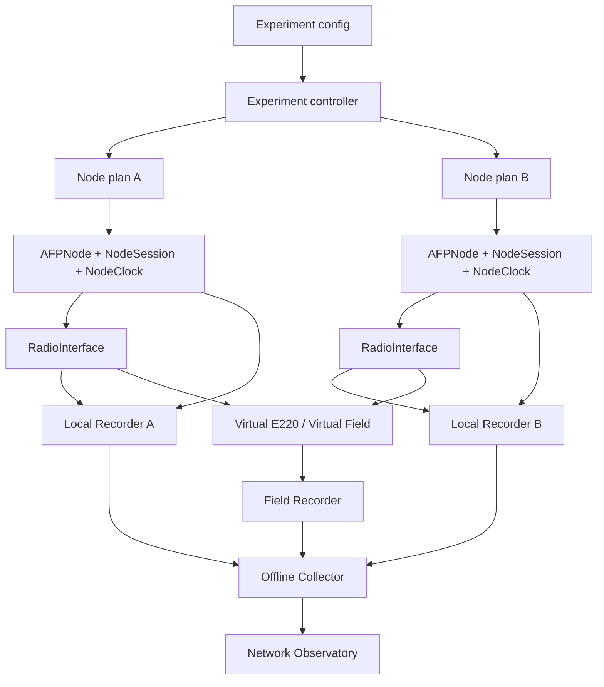

# AFP Lab v0.3.0 — Distributed Experiment Recording

明野データ実験フィールド / 2026-11-25

v0.2 のネットワーク可視化、シナリオ定義、AFP wire format (v1 / 13-byte header) を継承し、実機移行を意識した構造に改修しました。**今回はプロトコル機能や電波伝搬モデルの高度化ではなく、実験基盤の修正が目的です。** すべての同梱データはシミュレーションによるもので、E220 の実測値ではありません。

## Windows での実行

ZIPを新しいフォルダに展開してください。Python 3.10以上、標準ライブラリのみ。追加パッケージやサーバーは不要です。

```cmd
cd /d "%USERPROFILE%\Downloads\afp-lab-v0.3\afp-lab"
python -m unittest -v
python lab.py --open
```

ブラウザが開かなければ `start "" results\index.html`。macOS/Linux では `python3` も使用できます。実験済みのHTMLは直接開けます。保存したい実験には `--out experiments/my-run` を指定してください。既定の結果は再実行で上書きされます。

## まず試してほしいこと

1. シナリオ 02 (Hidden-node collision) を選び、最後へ `>|` を押します。観測視点「統合」では Field の衝突が2件見えます。
2. 「Localのみ（実機相当）」に切り替えて最後へ進めます。2件の送信要求、UART書き込み完了、配送0件とACK0件は確認できますが、RF送信回数・衝突原因は **—（不明）** になります。
3. シナリオ 06 (Independent node clocks) を選択。各端末の生時刻は8秒・3秒・15秒のオフセットを持ち、ドリフトも異なります。Collectorの補正後に同じ時間軸へ並びます。イベント詳細で raw (µs) と補正誤差を確認できます。
4. シミュレーターを再実行せず、保存済みログから同じレポートを再生成します。

```cmd
python lab.py --collect results/traces/01 results/traces/06 --out experiments/replay --open
```

`--collect` は Recorder ファイルを読み、仮想ノードや無線モデルを起動しません。フィールドログが欠けていればRF集計を不明にします。端末ログが欠けていればPDR/ACK率を不明にします。元ファイルは変更しません。

## 責務と依存関係



| ファイル | 責務 |
|---|---|
| `contracts.py` | RadioInterface, RxFrame, NodeClock。仮想フィールドを知らない契約 |
| `node.py` | AFPNode, NodeSession。端末自身の状態、受信処理、ローカルタイマー、端末別コマンド |
| `runtime.py` | SimulationEngine（仮想専用）、VirtualNodeClock、MonotonicRuntime（将来のホスト実装向けのポーリング式時計） |
| `radio.py` | VirtualE220 と Field。仮のホストUARTキュー、隠れたモジュールキュー、電波の衝突 |
| `recorder.py` | Local / Field Recorder、逐次JSONL出力、ログ検証、ClockMapping、オフライン集計 |
| `lab.py` | コンフィグ正規化・端末計画分割・仮想実験制御・CLI・レポート生成 |
| `observatory.html` | 統合 / Local / Field の表示、RFバーとLocalイベント、記録の完全性 |
| `afp.py`, `demo.py`, `test_afp.py` | 旧v0.1実装の保持。新しいAFPNodeはPacket codecのみ利用 |
| `test_v02.py`, `test_v03.py` | 回帰テストと分散記録テスト |

## 実験ディレクトリ

```
results/
  index.html                 # 自己完結型可視化
  experiments.json           # Collectorの結果（補正可能なイベントのみ）
  traces/01/
    manifest.json            # 実験条件、記録一覧、時計補正、件数、完全性
    plans/node-1.json        # 端末1が必要とする計画だけ
    plans/node-2.json
    plans/node-3.json
    node-1.jsonl             # 端末1の原記録
    node-2.jsonl
    node-3.jsonl
    field.jsonl              # 仮想無線の全知的記録。端末からは参照不可
```

`manifest.json` には `node_plans`（共通端末設定と各端末のコマンド）と `virtual_environment`（距離、地形の代替モデル、端末時計の仮定、モジュール内部容量など）が別に保存されます。端末に他の端末の予定や電波到達範囲を配布する必要はありません。シナリオSHA-256は正規化済み条件のハッシュで、同一条件のシミュレーションIDは決定的です。実機実験では新しい一意のexperiment_idを発行してください。

## シナリオ定義

v0.2 JSONはそのまま使用できます。新しい設定例：

```json
{
  "name": "My distributed experiment",
  "duration_s": 5,
  "radio": {"radius_m": 1000, "queue_capacity": 2, "module_queue_capacity": 4},
  "nodes": [
    {"id": 1, "x": 0, "y": 0, "clock_offset_us": 8000000, "clock_drift_ppm": 120, "start_delay_s": 0.05},
    {"id": 2, "x": 800, "y": 0}
  ],
  "messages": [{"at": 0, "src": 1, "dst": 2, "payload": "temperature=19.8"}]
}
```

- `duration_s`: 実験の共通観測窓。未指定なら最後の予定送信時刻+30秒。時間内のイベントのみ記録。終了時刻までに届かなかったものは窓内の未配送。観測窓以後の配送を推定しない。
- `messages[].at`: 端末の実験コマンド開始時刻からのローカル秒。`start_delay_s` は仮想実験でコマンド開始をずらす（電源投入や受信開始をずらす機能ではない）。時計オフセット・ドリフトとは独立。
- `clock_offset_us`, `clock_drift_ppm`: 仮想時計の仮定。デフォルト0。実機には既知のドリフトがあると仮定しない。
- `queue_capacity`: ホスト側の未完了UART送信の上限。v0.2のRF完了まで占有する定義を変更。
- `module_queue_capacity`: 仮想E220の内部キュー＋送信中の容量。溢れたらFieldにだけ `module_drop` を記録。実機内部容量は未知。
- `radio.send` のTrueはホスト受付だけを意味する。UART完了・RF送信・配送・認証は保証しない。

## ログ契約（trace schema 1）

各ストリームのJSONLは1行1イベント。UTF-8。時刻は整数マイクロ秒。必須共通フィールドは次の通りです。

| フィールド | 意味 |
|---|---|
| schema_version | 1 |
| experiment_id | 同じ実験内で共通 |
| stream_id | node-1など、記録ストリームのID |
| mode | simulation または physical |
| source | local または field |
| node_id | localの所有端末ID、fieldはnull |
| event_seq | ストリーム内の1始まりの連番 |
| t_us | 端末独自の単調時計（原値） |
| event | イベント種別 |

Localイベント: `origin`, `admitted`, `queue_drop`, `uart_tx_end`, `rx`, `deliver`, `relay`, `ack`, `duplicate`, `ttl_drop`, `send_rejected`, `invalid_frame`, `uart_error`。`rx` の `src` はAFPパケットの元送信者。直前のRF送信者は不明です。`local_tx_id` は端末内だけの送信識別子。`rssi` がない場合は null。Fieldイベント: `tx`, `rf_tx_end`, `rf_rx`, `collision`, `half_duplex`, `filtered`, `no_receiver`, `module_drop`。`txid` は仮想Field内の識別子で、端末には提供されません。フィールドから推定されたSNR/RSSIを作らない設計です。

集約時に `t_us` を保持したまま `aligned_t_us`, `t`（秒）, `clock_uncertainty_us` を追加。補正式は `reference_us + round((t_us - local_anchor_us) * scale)`。仮想時計の補正係数はモデルの既知値で、実測の時刻同期精度を示すものではありません。実機ではPC/GPS/NTPなどの実測アンカーと不確かさを与える必要があります。未同期なら補正タイムラインに配置せず、原記録を保持。時刻が同じ別ストリームの表示順は因果関係を保証しません。

各stream descriptorは `complete` と `record_count` を持ちます。欠損・件数不一致は完全な記録として扱わず、連番や所有者の矛盾はエラーとします。これは暗号学的な完全性検証ではありません。PDR/ACK率は完全なLocal記録が揃った場合のユニークな送信要求に対する観測窓内の割合。ACK RTTは同じ送信端末の単調時計だけで計算。RF指標は完全な仮想Fieldログがある場合のみ算出し、実機ログの不足を原因推定にすり替えません。airtime_sum_sは開始された仮想送信のモデル上の全予定時間の合計（同時送信は重複計上、観測窓で打ち切った送信も予定値）。

Pythonホスト側では `JsonlSink` をRecorderの `sink` に渡し、`retain=False` でRAMに全件保持しない逐次保存ができます。独占新規作成、毎行flush。電源断耐性の保証やAtom LiteのFlash/USB収録はまだありません。ESP32側は同じ契約をC++等で実装する予定です。

## 検証と未実装

- v0.1/v0.2由来15件＋v0.3追加15件、合計30件。Linuxで実行確認。既存5シナリオの主要配送/ACK/RF/衝突/キュー指標と01のRTTは維持。新規06の時計ずれ・ドリフトも検証。
- 追加検証: RFログなしの再集計、欠損/切れたLocalログ、未同期時計、仮想真値混入の拒否、ホストキューとモジュールキュー、端末別計画、スタブRadio＋独立時計、物理ログ形式の構成済みテストデータ、逐次JSONL、観測窓、開始時刻ずれ。
- HTMLをChromiumへ読み込んで操作確認。Windows上でのv0.3実行は未確認。
- シミュレーションは1プロセスの決定的なイベント駆動。端末ランタイム境界は分離したが、OSプロセス分離・実UARTドライバー・ESP32ファームウェア・実機側の開始/停止制御・時刻同期手順・Flash耐久性は未実装。モジュール内キュー、RF時間、伝搬、フレーミングは近似モデル。LBT/日本の技適条件を評価するモデルではない。
- 仮想RF状態を用いた送信制御は実装していない。将来の研究で必要な時刻同期、再送、TDMA、経路探索、端末再起動時のIDと連番の永続化、認証/暗号化、地形・RSSI/SNRの実測補正は次段階。現状は実験用プロトコルであり実運用向けではない。

旧READMEは `README-v0.2.md` / `README-v0.1.md`。設計変更の背景は `DESIGN-v0.3.md`。
