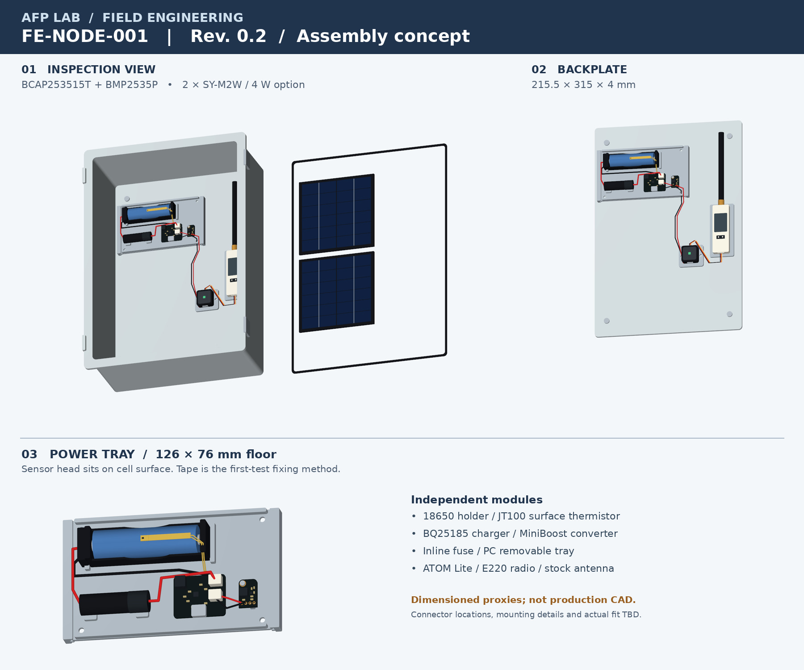

# AFP Lab — FE-NODE-001 Rev.0.2 concept

2026-11-27 | 端末全体の実寸ベースの配置検討用3Dモデル（仮設計）

## 目的と状態

FE-PWR-001 Rev.0.1で選定した電源とATOM Lite / LoRaE220-920を、手持ちのタカチ BCAP253515T / BMP2535P に実装するための3Dアセンブリです。完成回路・安全設計・実寸部品の最終嵌合を保証する製作用データではありません。2026-11-27にGitHubへ初期モデルを公開しました。実機製作・安全性検証は未完了です。

関連資料：[Field Engineering](../../docs/field-engineering.md) / [FE-PWR-001 電源設計・BOM](../../docs/field-engineering/power-module.md)

**English summary:** Reproducible, dimension-based concept assembly for the AFP Lab field node. Includes editable GLB scenes, a STEP assembly, parametric Python source and a component register. Geometry includes approximations; it is not a fabrication-ready or safety-validated design.

## Blenderで開く

1. リポジトリをクローンするか、GitHubのCode > Download ZIPから展開する。対象フォルダは `hardware/field-node/`。単体確認なら [inspection.glb](AFP_FE_Node_Rev0_2_inspection.glb) をダウンロードする。
2. Blenderで新規ファイルを開き、File > Import > glTF 2.0 (.glb/.gltf) から任意のGLBを読み込む。
3. Aで全選択、Home（Frame All）で全体を表示。Material PreviewまたはSolidのMaterial色で色分けを確認する。
4. Scene Properties > UnitsをMetric、Unit Scale 1.0、Length Millimetersに設定する。GLBの座標はメートル単位で保存済みなので追加の倍率変更は不要。
5. Outlinerで部品グループ（Empty）を選択・移動・表示切替できる。2W構成は `16_PV_2_SY_M2W` とその子部品を非表示にする。透明面だけを隠す場合は `Transparent_PC_face` を非表示にする。
6. File > Save Asで.blendとして保存する。

Blender自体は生成環境にインストールされていないため、ネイティブ.blendは直接生成・動作確認していません。GLBはtrimeshで再読み込み確認済みです。オプションの `make_blend.py` はローカルBlenderのコマンドラインから実行する補助スクリプトです（未実行）。

## ファイル一覧

| ファイル | 用途 |
| --- | --- |
| `AFP_FE_Node_Rev0_2_inspection.glb` | 推奨。蓋を横に外した状態で全体を確認する。実際のヒンジ開き方を表すものではない |
| `AFP_FE_Node_Rev0_2_assembled.glb` | 透明蓋を閉じた4W構成 |
| `AFP_FE_Node_Rev0_2_backplate.glb` | ボックスを省略し、背面プレートと機器の実装を確認 |
| `AFP_FE_Node_Rev0_2_tray.glb` | 電源カートリッジと固定レールの拡大確認 |
| `AFP_FE_Node_Rev0_2_mechanical.step` | FreeCAD等で開くソリッド中心の概略アセンブリ（電線や一部電子部品を省略） |
| `AFP_FE_Node_Rev0_2_preview.png` | GLBの実際のジオメトリから作成したレンダリング |
| `build_model.py` | CadQueryによる寸法・部品・配置の再生成ソース。寸法はmm |
| `make_blend.py` | ローカルBlenderでGLBを読み込み.blendに変換する補助スクリプト |
| `component_register.csv` | 部品グループと基準座標、再現精度の注意点 |
| `render_preview.py` | プレビュー生成ソース（VTK/Pillow） |

## 設計方針

- X方向=幅、Y方向=据付時の上下（+Yが上）、Z方向=背面から蓋方向。原点は筐体背面中央。glTFにはY-up変換を適用している。
- 筐体内寸の余裕を活用し、左上に電源モジュール、右にLoRaユニット・純正アンテナ、下寄りにATOM Lite。下側を拡張と保守用の空間として残す。
- パネル2枚は透明PC蓋の内側に縦に並べる。1枚のみなら上側を使用。パネルは116mm角、モデルの間隔8mm（合計240mm）。電源トレーのセル位置を上側パネルの投影内に配置する。アンテナ中心X=79mm、パネル右端X=15mm、アンテナ径を8mmとした投影上の端部距離60mm。実際の電波伝搬は未検証。
- PCトレーの床126×76×2.5mm、固定レール込み外形134×76mm。レールは背面プレート側に独立、脱落防止の終端ストッパーや固定穴は今後設計。電源基板と電池を交換可能な配置。
- 103JT-100の検出先端はセル中央の曲面に沿わせて配置した。初号機は薄い絶縁テープで固定し、押さえブリッジはメーカー確認後のオプションとする。SEMITECの資料は押付け・締付け等で取り付ける場合にメーカー相談を求めている。リードの折り曲げ条件とテープの適合性を確認する。
- ホルダーの底面穴の長手方向位置は中心±17.3mm、径2mmと読み取れるが、幅方向位置と用途、ねじ頭のセルとの干渉が未確認なので、このモデルではホルダーを貫通するねじを設けない。
- 充電基板・昇圧基板・Fuse・M5のポート形状や配線は実際の部品に近い配置検討用モデル。コネクタ位置・線長・電気的結線を保証しない。蓋側ソーラー配線・開閉時サービスループは未実装。

## 寸法と出典

| 部材 | 寸法 mm | 出典と再現度 |
| --- | --- | --- |
| BCAP253515T | nominal 250×350×150、内寸最大223.5×323.5×133.6 | タカチ 2020-07-20の図面。旧型を使用。ボディ・蓋・ラッチは簡略形状。151mm表記との差や外部突起は現物確認 |
| BMP2535P | 215.5×315×4、4-φ8、180×268.5ピッチ、裏面127×212×6リブ | タカチ 2017-05-16図面。四隅形状とリブ断面は簡略 |
| 1S1P-18650 | 樹脂本体75、販売外形80×21×18.6 | ユーザー提供 `5597_technical drawing.pdf` p2、販売ページ。断面・PCM・接点・端部は簡略 |
| 18650 | φ18.2×65を仮採用 | セル型番ごとの実寸を確認。ホルダーとの接触部は簡略 |
| BQ25185 #6091 | 32×26.3×7.2 | Adafruit公称外形。公式STEPの取得失敗により独自の寸法プロキシを使用。固定穴・ポート位置は未確定 |
| MiniBoost #4654 | 11.43×17.78、穴φ2.5、4端子φ1.0 | 公式EagleCADから平面外形・穴・部品XY中心を取得。Z寸法・部品外形は近似 |
| 103JT-100 | 全長100、幅3.6±0.5、最大厚0.5 | SEMITEC図面。先端をセル表面に置いた。リードの全長・曲げ経路は未再現 |
| SCHURTER 8601.2000 | 5×20mmヒューズ用、ホルダー外形予約約45×φ13 | 外形は仮のスペース確保。公式CADを取得できていない |
| ATOM Lite C008 | 24×24×9.5 | M5Stack公式資料、M2穴1個。穴の位置、端子の形状、ねじ長は要確認 |
| LoRaE220-920 U170 | 71.4×24×8、アンテナ全長110 | M5Stack公式資料。筐体・端子・取付穴とSMA外形は簡略 |
| SY-M2W | 116×116×3、2×6セル | 秋月電子/メーカー仕様。裏面端子と固定材は簡略 |
| トレー | 126×76×2.5（床）、固定レール込み134×76 | 本設計の仮寸法。組立高さ・余白・穴・ストッパーは現物確認後確定 |

### 参照URL（2026-11-27）

- https://www.takachi-el.co.jp/assets/attachments/images/BCAP253515G.pdf （p1, p2。型番Tも記載）
- https://www.takachi-el.co.jp/assets/attachments/images/BMP2535P.pdf （p1）
- https://www.batteryspace.jp/shopdetail/020001000001/ （販売仕様）
- https://gigaplus.makeshop.jp/allbattery/5597_technical%20drawing.pdf （ユーザー添付図面）
- https://www.adafruit.com/product/6091
- https://learn.adafruit.com/adafruit-bq25185-usb-dc-solar-lithium-ion-polymer-charger/downloads
- https://github.com/adafruit/Adafruit_CAD_Parts/tree/main/6091%20bq25185%20USB%20Charger （公式STEP等の配布元、現モデルには取り込めていない）
- https://www.adafruit.com/product/4654
- https://github.com/adafruit/Adafruit-TPS61023-PCB （Adafruit TPS61023.brd、rev Bの平面情報を参照）
- https://www.semitec.co.jp/uploads/2022/01/jt_thermistor2015.pdf
- https://www.schurter.com/en/part/8601.2000
- https://docs.m5stack.com/ja/core/Atom-Lite
- https://docs.m5stack.com/en/unit/Unit_LoRaE220-920
- https://akizukidenshi.com/goodsaffix/SY-M2W_a.pdf

## 残課題・安全上の制約

本アセンブリは形状検討用で、製作用図面や3Dプリント済み部品の性能確認ではない。CADの見た目と通電の適合性は独立。機器の充電温度保護、低電圧停止、5.2V出力の適合、ヒューズ・配線保護、結露・放熱・防水・耐候性、固定強度、アンテナの影響を確認するまで無人運用は行わない。筐体上部・透明蓋は太陽光による昇温の評価が必要。

製作リリース前に、メーカーCAD差し替え、実物測定（ホルダー穴、PCB固定穴、端子位置、取付ベース裏のリブとねじ長、蓋の取付面、パネル固定構造）、正式配線設計、干渉検証、PLA寸法試作、PCの造形・熱変形確認を行う。意図した部品の接触・嵌合を含む概略アセンブリのため、自動干渉解析に合格した状態ではない。STLはまだ製作用に出力しない。
